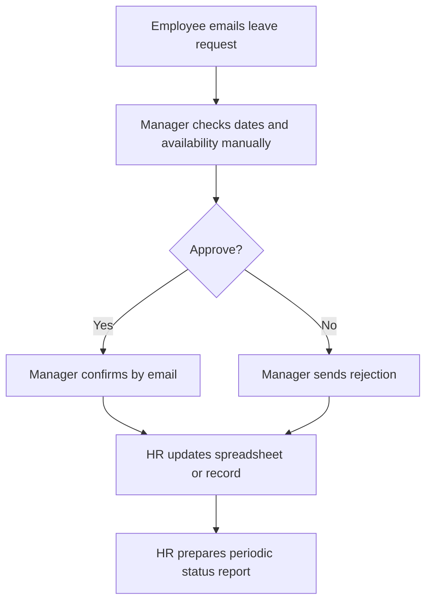
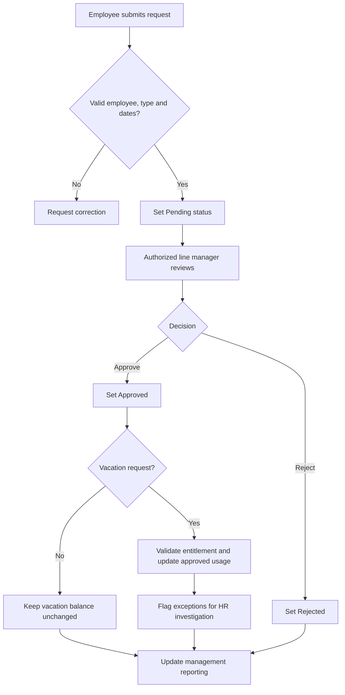

# Employee Leave Approval — Current and Future State Process Maps

These are **illustrative conceptual workflows** for the synthetic case study, not observed processes at a real employer. The current state represents a plausible manual baseline; the future state represents the requirements in [REQUIREMENTS_AND_RULES.md](REQUIREMENTS_AND_RULES.md).

## Illustrative current state — manual approval

**Potential pain points (hypotheses):** duplicate entry, inconsistent status updates, delayed reporting, limited visibility into remaining balances.

## Proposed future state — controlled leave workflow

## BA validation questions
- Who is authorized to approve a request when the line manager is absent?
- Can an employee cancel an approved request, and how is its balance restored?
- What are the carry-forward, adjustment and entitlement policies?
- How are overlapping requests and non-working days handled?

These policy decisions are intentionally open; the diagrams should not be mistaken for a production-ready HR workflow.
