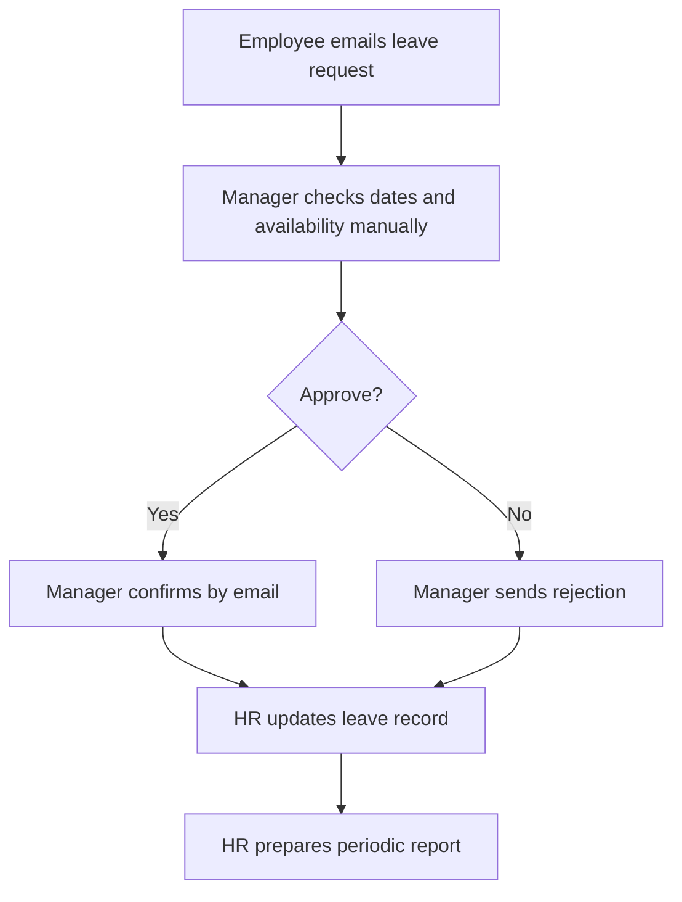

# Employee Leave Management | Process Analysis

This independent case study uses synthetic data and illustrative workflows. The diagrams describe proposed business processes, not a deployed HR application or executed workflow tests.

## Illustrative current state (AS-IS)

In the manual baseline, an employee emails a leave request to their manager. The manager checks dates and availability, communicates an approval or rejection by email, and HR updates a spreadsheet or leave record and prepares periodic reports. Possible pain points include duplicate entry, inconsistent status tracking, limited balance visibility and delayed reporting. These are hypotheses, not findings from an actual employer.

## Original conceptual workflow

The original employee/line-manager swimlane on page 1 of the editable Draw.io file illustrates request creation, submission, manager decisions, correction/resubmission and a basic cancellation path. It is retained as an early conceptual design and **is not the manual AS-IS process** described above. The cancellation path is expanded separately on page 3.

## Proposed future state (TO-BE)

1. **Submit and validate:** An employee submits a request with leave type, dates and requested days (FR-01). The proposed process validates employee, leave type and dates (BR-01). Invalid requests return for correction and resubmission.
2. **Pending and manager review:** Valid requests are recorded as Pending (FR-03). An authorized manager reviews a direct report's request (FR-02, BR-02); self-approval is prohibited (BR-03). Rejected requests are recorded as Rejected.
3. **Leave-type handling:** Following manager approval, non-vacation leave is approved without changing annual vacation entitlement (BR-07). Vacation requests proceed to an entitlement check before final approval.
4. **Entitlement check:** Vacation requests within available entitlement can be approved, with approved usage reflected in the balance (FR-04, BR-04, BR-05). Insufficient entitlement is referred for HR policy review rather than automatically approved.
5. **Policy exception:** An authorized exception or adjustment may permit approval; otherwise the request is held or declined pending policy decisions. Authorization and adjustment rules require stakeholder confirmation (BR-05).
6. **Reporting and investigation:** Finalized outcomes support management reporting by status, department, leave type and month (FR-06). Separately, existing approved-usage discrepancies are flagged for HR investigation (FR-05, BR-08); flagged records are not automatically considered valid or invalid.

The PNG above is the conceptual design reviewed for this case study. The editable file, containing all three pages, is [Employee_Leave_Management_Process_Flows.drawio](Employee_Leave_Management_Process_Flows.drawio).

## Cancellation (proposed extension)

An employee requests cancellation of previously approved leave. The authorized manager or HR reviewer decides whether to approve cancellation. If rejected, the original request remains Approved and the outcome is recorded. If approved, the request is marked Cancelled; any applicable vacation balance restoration depends on confirmed policy. Both outcomes feed notifications and reporting. Cancelled requests are excluded from approved-leave totals (BR-06).

Cancellation authority, timing (including after leave begins), restoration and notifications are **open policy questions**. This is not a completed or tested workflow feature.

## Outstanding BA validation questions

- Who approves when the line manager is absent, and how is self-approval prevented?
- What are the rules for carry-forward, entitlement adjustments and policy exceptions?
- How should overlapping dates, non-working days and partial days be handled?
- Who may authorize cancellation, when is it permitted, and when should balances be restored?

Related documentation: [Requirements and Business Rules](REQUIREMENTS_AND_RULES.md), [User Stories and Acceptance Criteria](USER_STORIES_AND_ACCEPTANCE_CRITERIA.md), and [Traceability Matrix](TRACEABILITY_MATRIX.md).

**Diagram files:** The two PNG previews and the three-page editable Draw.io file are included in this folder. The original Microsoft Visio source is not included.
