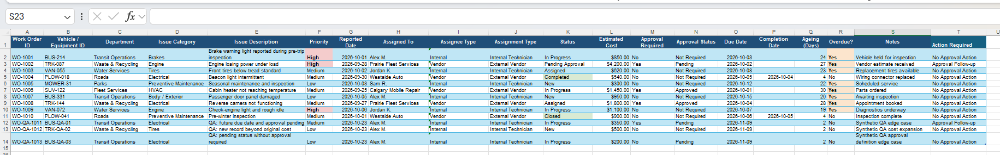
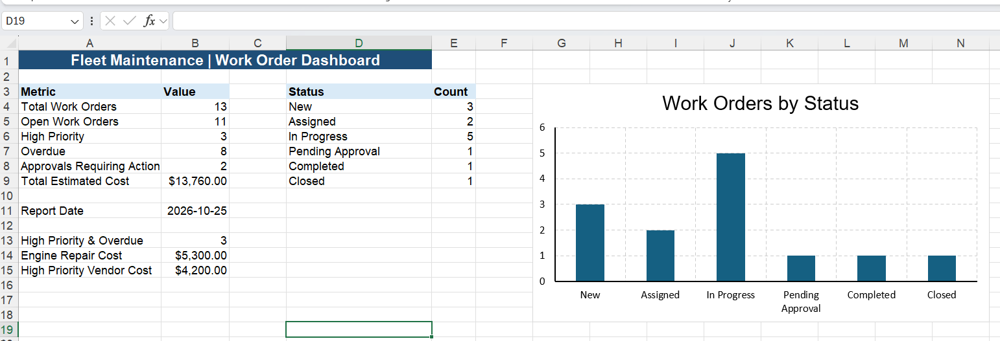
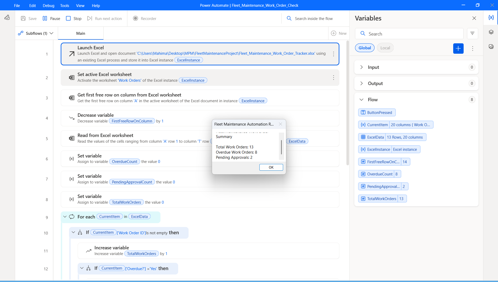
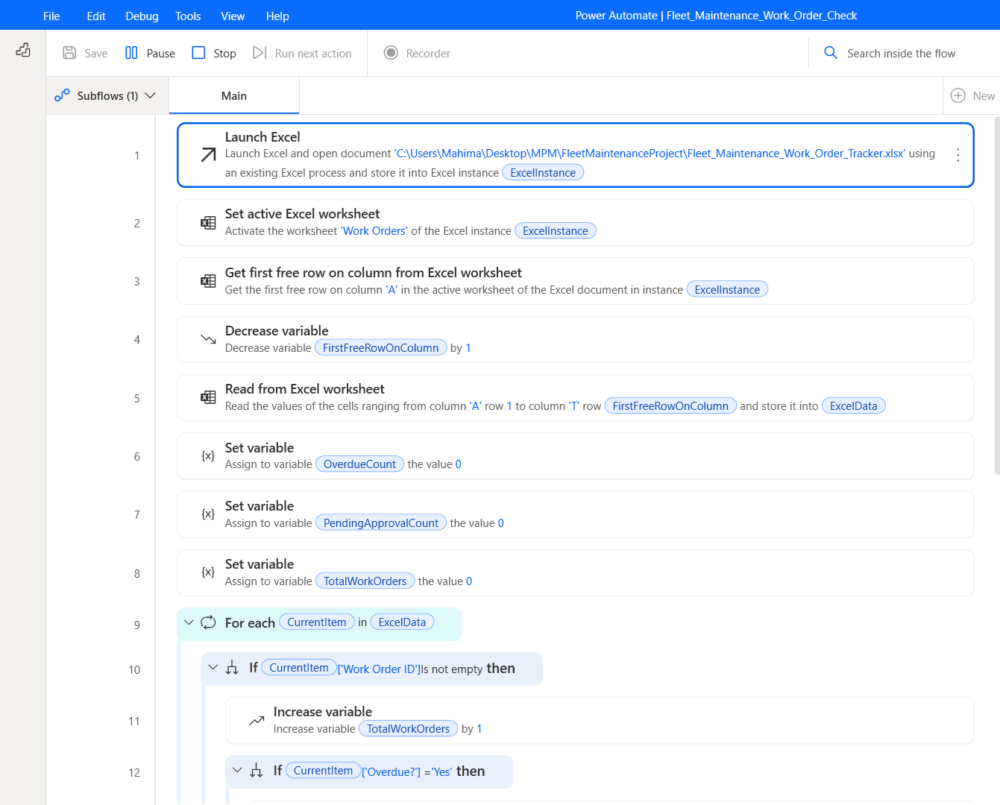
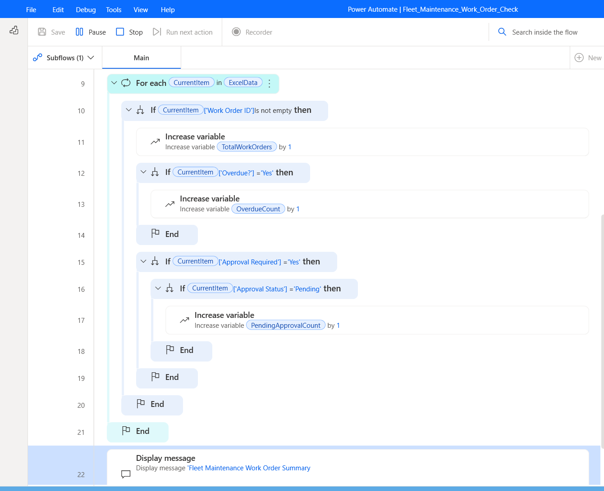
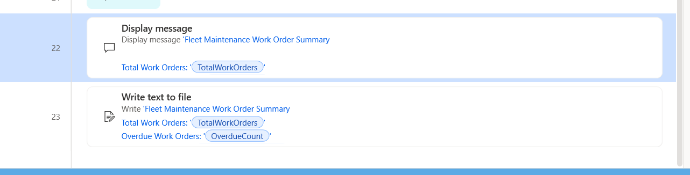

# Fleet Maintenance | Work Order & Approval Tracker

## Project Overview
An independent Business Analysis and QA portfolio case study using simulated maintenance work orders. The prototype combines an Excel register, Power Query, a Summary dashboard, PivotTables, and a Power Automate Desktop (PAD) flow that displays and saves a local summary report.

## Business Objectives
- Track work-order status, priority, assignments, due dates, and estimated costs.
- Identify overdue work and approvals requiring action.
- Reconcile source records, reporting outputs, and automated counts.
- Demonstrate requirements traceability and controlled UAT scenarios.

## Business Rules
- **Overdue:** the workbook's `Overdue?` field is `Yes`; this is date-dependent.
- **Approval action pending:** `Approval Required = Yes` **and** `Approval Status = Pending`. This is not the same as `Work Order Status = Pending Approval`.
- **Dynamic PAD import:** determine the last populated row from column A (Work Order ID) and read through that row. This assumes contiguous IDs in column A; gaps and large datasets were not tested.

## Verified Results
| Environment | Total work orders | Overdue | Approval actions pending | Estimated cost |
|---|---:|---:|---:|---:|
| Main workbook (PAD run) | 13 | 8 | 2 | CAD 13,760 (Excel Summary) |
| Separate UAT test copy | 14 | 0 | 0 | CAD 13,960 |

- PAD's main-workbook popup and saved text report were confirmed at **13 / 8 / 2**.
- Separate UAT-copy runs verified **13 / 0 / 2**, **13 / 0 / 0**, and **14 / 0 / 0** for the relevant scenarios.
- After adding `WO-QA-1014` to the UAT copy and using **Refresh All**, the Summary dashboard showed 14 records and CAD 13,960. The `Cleaned_Work_Orders` output included the new ID, and the estimated-cost PivotTable grand total reconciled to CAD 13,960.
- These are local, simulated tests, not formal business-user acceptance or production certification.

## Tools and Skills
- **Excel:** work-order register, formulas, Summary dashboard, PivotTables
- **Power Query:** cleaned reporting dataset and refresh
- **Power Automate Desktop:** column-based dynamic row detection, loops, conditional counting, popup, text report
- **BA/QA:** business rules, BRD, traceability, test scenarios, defect and retest documentation

## Documentation and Artifacts
The latest main workbook, revised BRD and final UAT report are available below. Historical artifacts are listed separately for traceability and are not part of the current tested baseline.

- **[Revised BRD: final PDF](Fleet_BRD_Final.pdf)**: Version 2.0, corrected approval rule and tested scope
- **[Final UAT report: PDF](Fleet_Maintenance_UAT_Final.pdf)**: Version 2.1, nine recorded scenarios
- **[Final main Excel workbook](Fleet_Maintenance_Work_Order_Tracker.xlsx)**: 13-record main dataset
- [Revised Requirements and Acceptance Criteria](FLEET_BRD_REVISED_DRAFT.md)
- [UAT Execution Record](FLEET_UAT_EXECUTION_CHECKLIST.md)
- [QA Defect Register](FLEET_QA_DEFECT_REGISTER.md)
- [Verification and Release Status](FLEET_VALIDATION_AND_RELEASE_STATUS.md)
- [Formula and Business Logic Guide](Fleet_Maintenance_Formula_and_Business_Logic_Guide.md): corrected current approval-action rule and formula explanations

### Archived prototype artifacts (not current deliverables)
- [Original BRD PDF](Fleet_Maintenance_BRD.pdf): historical 10-record baseline
- [Original UAT PDF](Fleet_Maintenance_UAT_TestCases.pdf): historical 10-record baseline
- [Original Excel workbook](Fleet_Maintenance_Work_Order_Tracker_Portfolio.xlsx): historical prototype

**File naming note:** The revised BRD was uploaded as `Fleet_BRD_Final.pdf`; this is the version 2.0 BRD, not the historical BRD.

## Current Project Screenshots

The images below document the **13-record main-workbook baseline**, including the corrected approval-action metric. The overdue count is a snapshot as of 25 October 2026 and may change with the report date.

### 1. Work Order Register
All 13 simulated work orders, including the approval-required and approval-status fields.

### 2. Excel Summary Dashboard
Operational KPIs, status breakdown and chart. **Approvals Requiring Action (2)** is distinct from **Pending Approval status (1)**.

### 3. PAD Execution and Results
The PAD run uses the final workbook path and displays **13 total / 8 overdue / 2 approval actions pending**.

### 4. PAD Excel Setup and Dynamic Row Detection
Column-A first-free-row detection, adjustment to the last populated row, and reading through column T.

### 5. PAD Conditional Counting Logic
Independent overdue check and nested **Approval Required = Yes** plus **Approval Status = Pending** conditions.

### 6. PAD Reporting Actions
Popup summary and local text-file output actions.

**Historical evidence:** The earlier screenshots (original 10-record baseline) remain in the `screenshots` directory for traceability but are no longer used as the primary project gallery.

## Limitations
Synthetic data, local desktop execution, no deployed Power Apps application, no cloud approval workflow, no production integrations, and no formal user sign-off. PAD's column-A method assumes contiguous work-order IDs. Excel summary formulas use a finite supported range; automatic expansion beyond that range and performance at scale were not tested.
