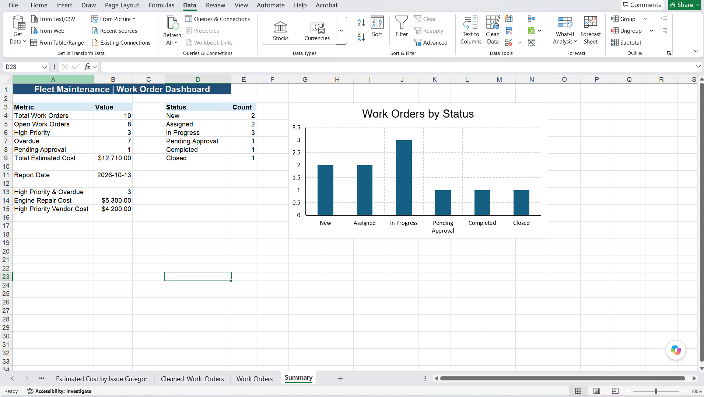
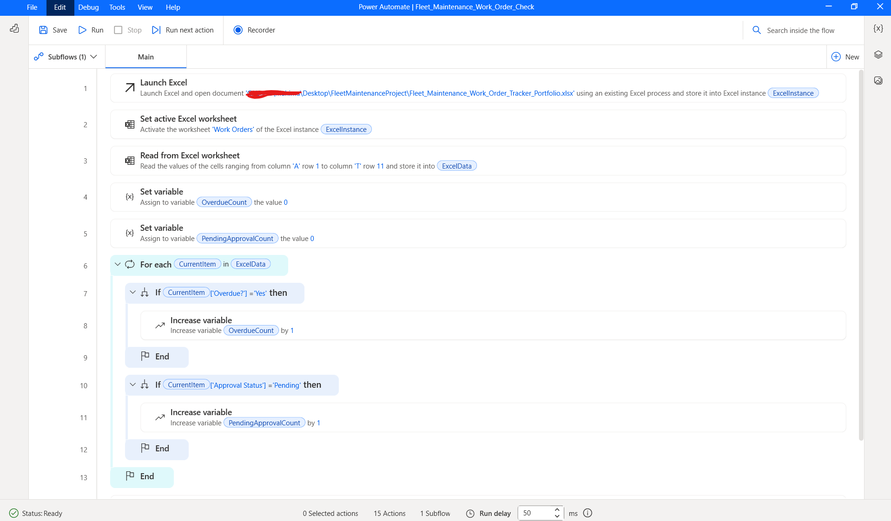
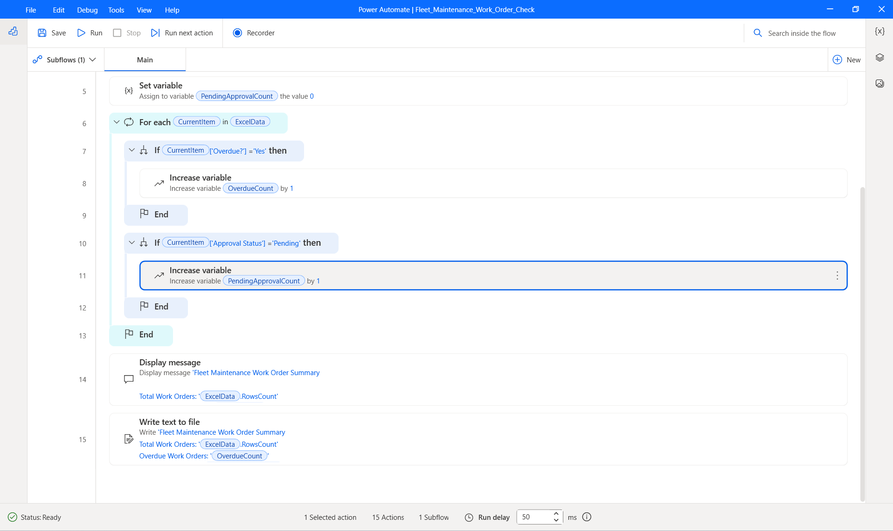
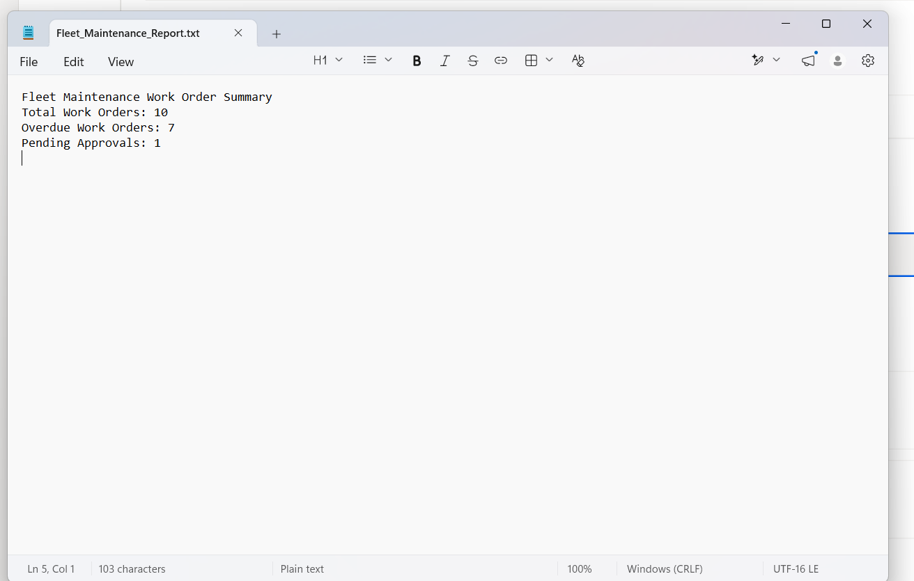
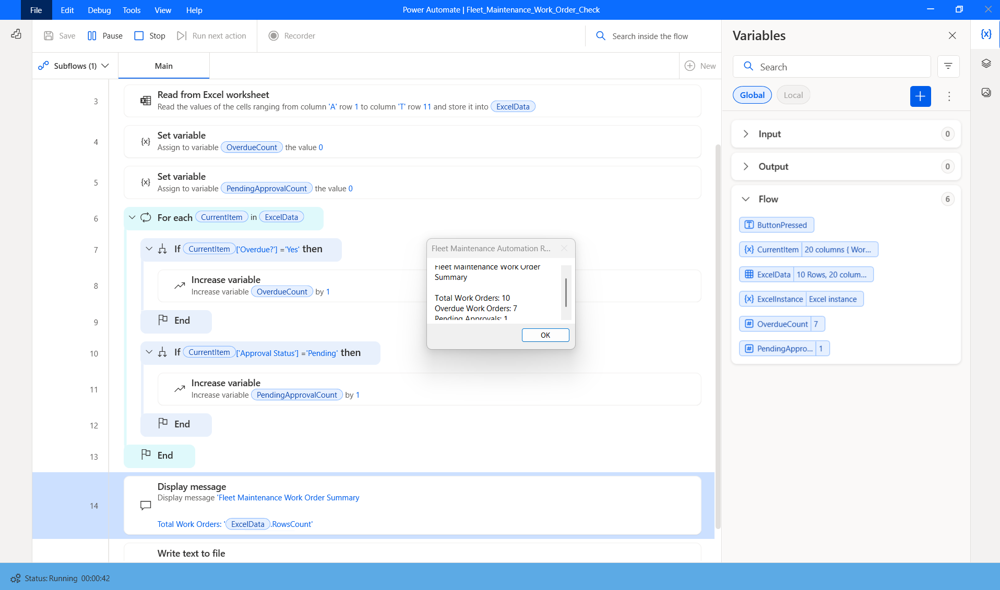

# Fleet Maintenance | Work Order & Approval Tracker

## Project Overview
A simulated Business Analyst portfolio project focused on tracking maintenance work orders, identifying overdue tasks, and monitoring approval requirements.

The solution combines an Excel-based tracker, Power Query transformations, a summary dashboard, and Power Automate Desktop reporting.

## Business Objectives
- Improve visibility into work-order status and priority.
- Identify overdue work orders and pending approvals.
- Support maintenance planning through consistent tracking and reporting.

## Tools & Skills
- **Microsoft Excel:** Work-order tracking, formulas, and dashboards
- **Power Query:** Data cleaning and transformation
- **Power Automate Desktop:** Excel integration, variables, For Each loops, IF conditions, and automated reporting
- **Business Analysis:** Requirements documentation, business rules, and UAT scenarios

## Solution Features
- Structured work-order register with status, priority, assignment, cost, and approval fields
- Dashboard showing operational KPIs and work-order status distribution
- Desktop automation that reads Excel records, evaluates overdue and approval conditions, and generates a summary report

## Documentation
- [Business Requirements Document](Fleet_Maintenance_BRD.pdf)
- [UAT Test Cases](Fleet_Maintenance_UAT_TestCases.pdf)
- [Excel Work Order Tracker](Fleet_Maintenance_Work_Order_Tracker_Portfolio.xlsx)
- [Formula and Business Logic Guide](Fleet_Maintenance_Formula_and_Business_Logic_Guide.md)
  
## Screenshots
### Excel Dashboard

### Power Automate Desktop — Workflow Logic

### Power Automate Desktop — Reporting

### Generated Summary Report

### Successful Automation Test
The Power Automate Desktop test processed 10 work orders and identified 7 overdue work orders and 1 pending approval.

## Project Notes
This project uses simulated data for learning and portfolio purposes. The automation was developed and tested using Power Automate Desktop; it does not include a deployed Power Apps application or cloud-based approval workflow.
